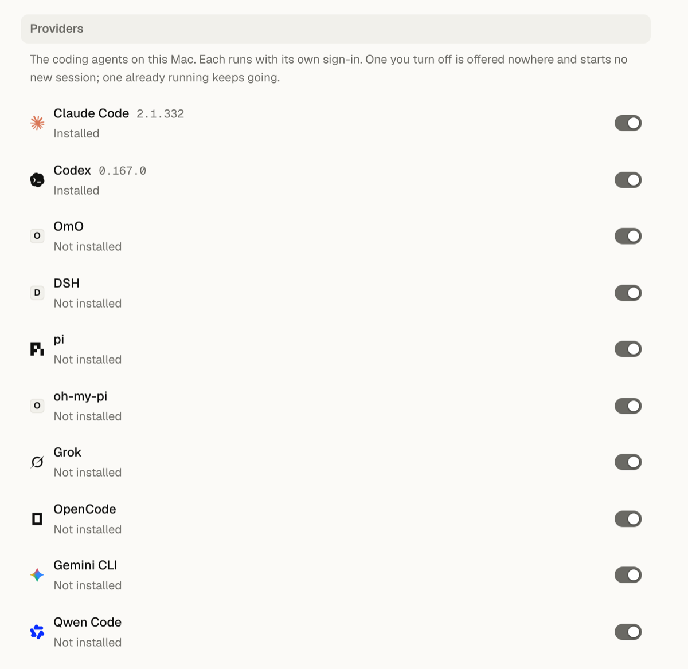
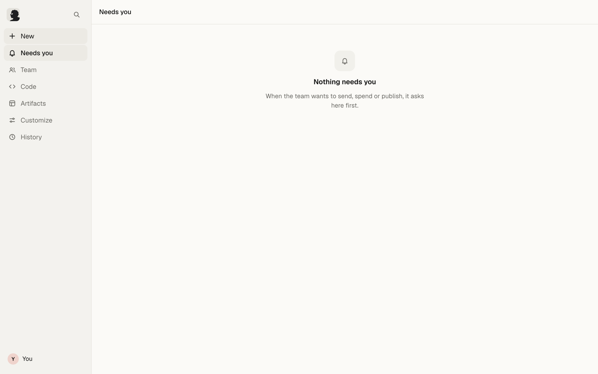
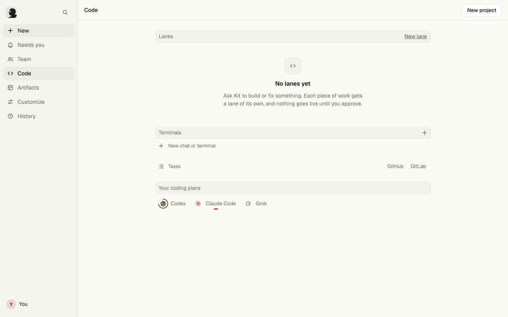

<p align="center">
  
</p>

<h1 align="center">Manut AI</h1>

<p align="center">
  <b>Your shop's AI crew and a code editor that actually ships. One Mac app. You stay the boss.</b>
</p>

<p align="center">
  <a href="https://github.com/mygogocash/manut-ai/actions/workflows/ci.yml?query=branch%3Apilot%2Fweek-1"></a>
  <a href="https://github.com/mygogocash/manut-ai/releases"></a>
  
  
  
  
  
  
</p>

<p align="center">
  <a href="#get-it">Get it</a> ·
  <a href="#what-it-does">What it does</a> ·
  <a href="#run-it-locally">Run it locally</a> ·
  <a href="#whats-in-the-box">What's in the box</a> ·
  <a href="#built-different">Built different</a>
</p>

---

## tl;dr

**Manut** (มนุษย์) is Thai for *human*. That's the whole idea: the AI does the busywork, the human makes the calls.

- **A chat that runs your shop.** Talk to Buddy and your AI team. They answer customers, draft replies, chase payments and remember what matters.
- **They ask before anything big.** Sending, spending or publishing lands in *Needs you* first. No surprise posts, no surprise bills.
- **A code editor that drives your agents.** Claude Code, Codex, Gemini CLI, Grok, OpenCode, Qwen Code, pi and friends, signed in with your own accounts, each job in its own lane, nothing live until you approve.
- **Built for Thai shop owners.** LINE, PromptPay and Thai baht are home turf, not plugins.

<p align="center">
  <picture>
    <source media="(prefers-color-scheme: dark)" srcset="docs/assets/readme/agents-dark.png">
    
  </picture>
</p>
<p align="center"><sub>Bring your own agents. Every coding tool on your Mac, one switch each.</sub></p>

## What it does

| | |
| --- | --- |
| **Buddy and the team** | One chat, a whole crew. Each member has a job (customer replies, research, admin) and a face of its own. Pause everyone with one button. |
| **Needs you** | The inbox for decisions. When the team wants to send, spend or publish, it asks here first, with the exact action spelled out. |
| **Kit, the code editor** | Ask Kit to build or fix something. Each piece of work gets a lane (its own git worktree), a diff you can read, and a pull request on GitHub or GitLab when you say so. |
| **Reads every command** | Kit reads what an agent wants to run. Reads and checks go alone; anything that writes, pushes or spends asks you, with the whole command shown and only the keys hidden. |
| **Report a problem** | One button gathers what's wrong (versions, which agents are signed in, the last errors), masks every key and path, and hands it to your own agent to fix. |
| **Practice mode** | Try the whole thing with a demo team. No account, nothing sent. |
| **Light and dark** | Warm off-white by day, soft charcoal by night, Geist everywhere. Quiet, not loud. |

<table>
  <tr>
    <td width="50%">
      <picture>
        <source media="(prefers-color-scheme: dark)" srcset="docs/assets/readme/needs-you-dark.png">
        
      </picture>
      <p align="center"><sub>Needs you: the team asks before it sends, spends or publishes.</sub></p>
    </td>
    <td width="50%">
      <picture>
        <source media="(prefers-color-scheme: dark)" srcset="docs/assets/readme/code-dark.png">
        
      </picture>
      <p align="center"><sub>Code: lanes, terminals, tasks and your coding plans in one place.</sub></p>
    </td>
  </tr>
</table>

## Get it

Grab the latest `.dmg` from [Releases](https://github.com/mygogocash/manut-ai/releases): `aarch64` for Apple silicon, `x64` for Intel.

> [!NOTE]
> 0.1.1 is a pre-release and it's **unsigned** for now, so macOS will side-eye it on first open. Go to System Settings, Privacy & Security, and press **Open Anyway**. A signed build is next.

## Run it locally

You need Node 26 (the LTS; `.nvmrc` says so), [pnpm](https://pnpm.io) and, for the desktop shell, stable Rust.

```bash
pnpm install          # only esbuild and workerd may run install scripts (pnpm-workspace.yaml)
pnpm test             # every package's tests
pnpm typecheck

pnpm --filter @manut/web dev    # the web app against an in-memory fake of the API
pnpm --filter @manut/web e2e    # the owner's pages in WebKit and Chromium at phone sizes (docs/phone-pass.md)
pnpm --filter @manut/api dev    # both Workers on localhost:8787: the API and the web app on one origin
```

The desktop app has its own guide: [`apps/desktop/README.md`](apps/desktop/README.md). Set `VITE_API_ORIGIN` to point the web app at a running backend, or to `same-origin` for the API that served the page. The backend's tests run in real workerd (`pnpm --filter @manut/api test`). Nothing here deploys anything; deploying is in [`docs/deploying.md`](docs/deploying.md).

## What's in the box

A pnpm monorepo. Three apps, a stack of small shared packages.

| Path | What it is |
| --- | --- |
| [`apps/desktop`](apps/desktop) | The Mac app: Tauri 2 shell in Rust, React 19 front end. Chat, Needs you, Kit, terminals and the coding-agent adapters. |
| [`apps/api`](apps/api) | The backend on Cloudflare Workers and Durable Objects: shops, people, tasks with exact-action approvals, an encrypted credential vault, schedules, retention. |
| [`apps/web`](apps/web) | The owner's approval page, invite links, the phone web app and the operator console, served from the API's own origin. |
| [`packages/*`](packages) | The shared rules: approvals that settle once, one event contract for every agent, money and time formatting, notification rules, PromptPay QR, the phone's encrypted channel, the design tokens, and more. |

The plan lives in [`docs/plan.md`](docs/plan.md) and the current state in [`docs/handoff.md`](docs/handoff.md). Every call we made and why is in [`docs/decisions.md`](docs/decisions.md).

## Built different

This repo is built by one human lead and a squad of AI coding agents working side by side, each in its own git worktree, each change reviewed and gated before it merges. Some receipts:

- **Thousands of tests, every push.** Vitest across the apps and packages, the API in real workerd, Rust on Linux and macOS, and a Playwright suite of 200+ specs in parallel shards.
- **Security reads on repeat.** Five rounds of security review so far, each one fixed and merged: what an approval shows is what runs, keys never reach a card or a phone, and a skill from a link can't sneak in settings.
- **Motion with manners.** Every move comes from one motion file, respects Reduce Motion, and stays out of your way ([`docs/motion.md`](docs/motion.md)).
- **Plain words.** No jargon on screen, four languages (English, Japanese, Korean, Chinese), with Thai on the list.

## Safety, but make it default

- The team **asks before** anything public, costly or irreversible. You approve the exact action, not a vibe.
- Coding agents run with **your own sign-in**, on your Mac. Kit reads each command before it runs and asks for anything that writes, pushes or spends.
- **Keys stay hidden** on every approval, notification and phone screen; a command that could hide something is shown whole instead.
- Deleting your account is **in the app**, two steps, and it takes your shop's data with it. What stays on your Mac stays.

The longer reads: [`docs/code-editor.md`](docs/code-editor.md), [`docs/remote-access.md`](docs/remote-access.md), [`docs/security/`](docs/security).

## Credits

Manut AI stands on good open-source shoulders: GoSpark (our own), Oh My Hermes, Orca, T3 Code, dtinth/promptpay-qr, Lobe Icons and more. Every one, with what we took and its licence, is in [`CREDITS.md`](CREDITS.md).

There's no licence file yet; that one is the owner's call. The code we borrowed keeps its own licence.

<p align="center"><sub>Made in Thailand by GoGoCash and a lot of agents.</sub></p>
